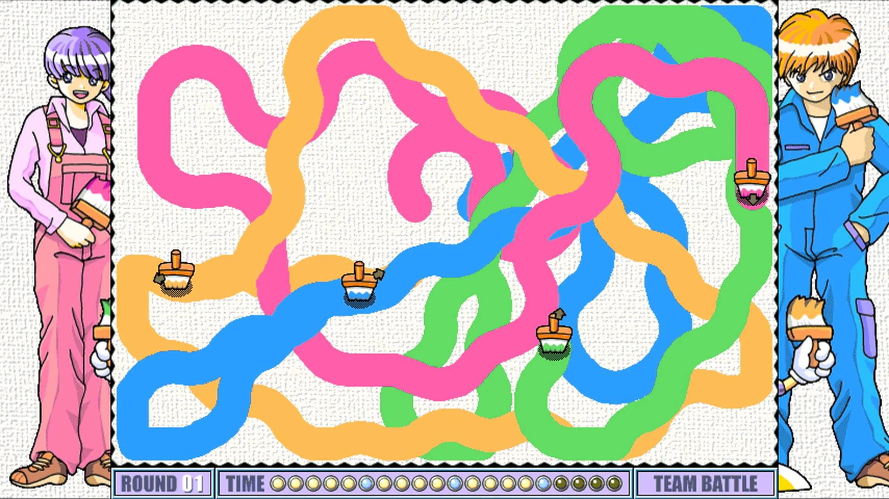

Paint Battle
=======

A party game inspired by the original **Battle Painters**: paint more of the canvas than everyone else in 90 seconds.

One big screen (laptop, TV, projector) shows the game; everyone steers their roller with their **phone**.



# Running it

Requires Node 18+. There is no build step.

```sh
npm install
npm start          # or: npm run dev  (restarts on server changes)
```

1. Open `http://localhost:3000/host` on the big screen.
2. Players scan the QR code (or browse to the address shown and type the room code).
3. The first player to join is the VIP ⭐ and starts the game from their phone, or press Enter on the big screen.

Phones must be on the same network as the computer running the server (or deploy it, see below).

**Testing without phones:** open a few extra browser tabs on `http://localhost:3000`. Each tab is a player; steer with ←/→ or A/D. Use `/host?seconds=15` for short rounds.

# How to play

- Hold the **left** or **right** half of your phone screen to steer. Press the other half to switch direction.
- Bumping into another roller makes you both jump; landing stuns you for 5 seconds (your phone buzzes).
- Grab the presents for power-ups: Magic Brush, Magic Shoe, Magic Clock (freezes the others), Magic Potion (the others run out of paint), Paint Bomb and Paint Rain.
- Big screen keys: Enter = start / play again, Space = pause, Esc = back to lobby, B = add bot, M = music on/off.

# How it works

```
phones ──input──▶ server.js ──▶ big screen (runs the game)
       ◀──state── (relay)   ◀──
```

- `server.js` serves `public/` and relays WebSocket messages within 4-letter rooms. It holds no game state.
- The big screen (`public/host.html`, `js/host.js`) runs the simulation and drawing (`js/game.js`) and sends each phone what to show.
- Phones (`public/index.html`, `js/controller.js`) only send `{ dir: -1 | 0 | 1 }`.
- Phones that drop out (locked screen, reload) reconnect to their slot automatically; while away their roller is driven by the AI. The big screen can also reconnect within 60 s without losing the room.

# Deploying

Any host that runs Node and supports WebSockets works. Set `PORT` if needed, and `PUBLIC_URL` (e.g. `https://paint.example.com`) so the QR code points at the right address.

# TODO
- Flashing yellow arrows with black border instead of a black line
- Pickups need images
  - Magic brush, Circle trail behind player
  - Magic shoe, Sparkle trail behind player
  - Magic clock, Dizzy effect while freezed (grey player with yellow sparkles)
- Ranking mode, highscore percentages
- Optional tilt steering on phones
